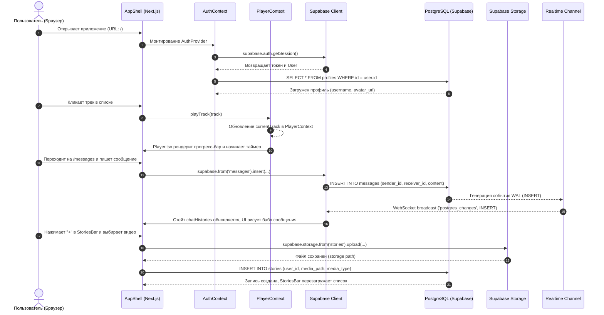

# 01. Архитектура проекта и структура файлов

## 1. Общее описание проекта Melo

**Melo** — это социальная музыкальная веб-платформа, объединяющая возможности музыкального стриминга и социальной сети.

### Основные пользовательские сценарии:
1. **Слушать музыку онлайн**: непрерывное воспроизведение треков через глобальный плеер во время навигации по сайту.
2. **Общаться в реальном времени**: обмен мгновенными текстовыми сообщениями между пользователями с отметками о прочтении, индикацией редактирования и удалением сообщений.
3. **Делиться историями (Stories)**: публикация фото и коротких видеороликов с временным доступом, просмотр историй друзей, реакции смайликами и ответы на истории прямо в личные сообщения.
4. **Управлять кругом общения**: поиск пользователей по юзернейму, отправка заявок в друзья, просмотр их музыкального статуса (что они слушают прямо сейчас) и возможность слушать трек вместе.
5. **Комнаты совместного прослушивания (Rooms)**: виртуальные комнаты, где участники синхронно слушают треки и общаются в общем чате.
6. **Плейлисты**: создание пользовательских подборок и доступ к избранным трекам.

### Технологический стек:
- **Фреймворк**: [Next.js](https://nextjs.org/) 16.3.6 (App Router)
- **Библиотека интерфейса**: [React](https://react.dev/) 19.0.0
- **Язык разработки**: TypeScript 5
- **Стилизация**: Модульный чистый CSS (CSS Modules), CSS Custom Properties (Design Tokens в `globals.css`)
- **Бэкенд и База Данных**: [Supabase](https://supabase.com/) (PostgreSQL, GoTrue Auth, Realtime WebSockets, Storage)
- **Клиентские библиотеки Supabase**: `@supabase/supabase-js` (2.49.1), `@supabase/ssr` (0.6.1)

---

## 2. Структура проекта и дерево файлов

```
c:/projects/music_project/
├── .env.local                   # Переменные окружения для подключения к Supabase
├── .gitignore                   # Список игнорируемых Git файлов и папок
├── eslint.config.mjs            # Конфигурация линтера ESLint
├── next-env.d.ts                # TypeScript-декларации типов Next.js (автогенерируемый)
├── next.config.ts               # Конфигурация Next.js (настройка удаленных изображений Unsplash)
├── package.json                 # Список зависимостей и скрипты запуска
├── package-lock.json            # Зафиксированные версии зависимостей npm
├── tsconfig.json                # Конфигурация компилятора TypeScript
├── public/                      # Статические ресурсы
│   ├── icons/                   # Иконки Дианы: меню, поиск, уведомления, плеер и лайки
│   └── music-placeholder.svg    # Обложка для треков без изображения
├── docs/                        # Полная проектная документация на русском языке
│   ├── README.md                # Главное оглавление документации
│   ├── 01_architecture_and_structure.md
│   ├── 02_database_and_security.md
│   ├── 03_features_and_modules.md
│   └── 04_setup_and_status.md
└── src/                         # Исходный код приложения
    ├── app/                     # Маршруты и страницы Next.js (App Router)
    │   ├── explore/             # Страница «Обзор»: поиск новинок и жанров
    │   │   ├── page.module.css
    │   │   └── page.tsx
    │   ├── friends/             # Страница «Друзья»: заявки, поиск, список друзей
    │   │   ├── page.module.css
    │   │   └── page.tsx
    │   ├── login/               # Страница входа в аккаунт
    │   │   ├── page.module.css
    │   │   └── page.tsx
    │   ├── messages/            # Страница личных сообщений (Realtime чат)
    │   │   ├── page.module.css
    │   │   └── page.tsx
    │   ├── playlists/           # Страница управления плейлистами
    │   │   ├── page.module.css
    │   │   └── page.tsx
    │   ├── profile/             # Профиль текущего пользователя и чужие профили
    │   │   ├── [username]/      # Публичный просмотр профиля по юзернейму
    │   │   │   └── page.tsx
    │   │   ├── page.module.css
    │   │   └── page.tsx
    │   ├── register/            # Страница регистрации нового аккаунта
    │   │   ├── page.module.css
    │   │   └── page.tsx
    │   ├── room/                # Музыкальные комнаты синхронного прослушивания
    │   │   └── [id]/
    │   │       ├── page.module.css
    │   │       └── page.tsx
    │   ├── settings/            # Настройки профиля (смена ника, bio, аватара)
    │   │   ├── page.module.css
    │   │   └── page.tsx
    │   ├── stories/             # Полноэкранный плеер историй
    │   │   └── [id]/
    │   │       ├── page.module.css
    │   │       └── page.tsx
    │   ├── globals.css          # Глобальные стили, темы и CSS переменные
    │   ├── layout.tsx           # Корневой шаблон приложения (монтирует AppShell)
    │   ├── page.module.css      # Стили главной страницы
    │   └── page.tsx             # Главная лента: истории, рекомендации, друзья
    ├── components/              # Переиспользуемые React-компоненты
    │   ├── AppShell/            # Оболочка всего интерфейса (провайдеры, лэйаут)
    │   │   └── AppShell.tsx
    │   ├── FriendCard/          # Карточка друга (статус, трек, слушание вместе)
    │   │   ├── FriendCard.module.css
    │   │   └── FriendCard.tsx
    │   ├── Header/              # Верхняя панель (поиск, профиль, вход/выход)
    │   │   ├── Header.module.css
    │   │   └── Header.tsx
    │   ├── Navigation/          # Боковая панель (десктоп) и нижнее меню (мобильные)
    │   │   ├── Navigation.module.css
    │   │   └── Navigation.tsx
    │   ├── Player/              # Фиксированный нижний аудиоплеер
    │   │   ├── Player.module.css
    │   │   └── Player.tsx
    │   └── Stories/             # Горизонтальная лента историй с кнопкой «+»
    │       ├── StoriesBar.module.css
    │       └── StoriesBar.tsx
    ├── context/                 # Глобальные React-контексты
    │   ├── AuthContext.tsx      # Контекст сессии Supabase Auth и профиля
    │   └── PlayerContext.tsx    # Контекст текущего трека и состояния плеера
    ├── data/                    # Демонстрационные данные
    │   └── mockData.ts          # Моки треков, комнат и друзей
    ├── lib/                     # Вспомогательные библиотеки и клиенты
    │   ├── supabase/            # Фабрики клиентов Supabase
    │   │   ├── client.ts        # Браузерный клиент createBrowserClient
    │   │   └── server.ts        # Серверный клиент createServerClient для SSR/Cookie
    │   └── supabase.ts          # Устаревший/резервный клиент Supabase
    ├── proxy.ts                 # Утилита обновления сессии (Next.js SSR cookies)
    └── types/                   # Декларации типов TypeScript
        └── index.ts             # Интерфейсы Track, Friend, Story, Message и др.
```

---

## 3. Схема связей файлов и импортов

Ниже представлена детальная диаграмма зависимостей и импортов между ключевыми частями проекта:

```mermaid
graph TD
    classDef page fill:#1e1e2f,stroke:#6c5ce7,stroke-width:2px,color:#fff;
    classDef comp fill:#2d3436,stroke:#00cec9,stroke-width:2px,color:#fff;
    classDef ctx fill:#2c3e50,stroke:#e17055,stroke-width:2px,color:#fff;
    classDef lib fill:#34495e,stroke:#fdcb6e,stroke-width:2px,color:#fff;
    classDef data fill:#2d3436,stroke:#b2bec3,stroke-width:1px,color:#dfe6e9;

    subgraph EntryPoint["Корневая точка входа"]
        Layout["src/app/layout.tsx"]:::page
        AppShell["src/components/AppShell/AppShell.tsx"]:::comp
    end

    subgraph Providers["Контексты и Провайдеры"]
        AuthCtx["src/context/AuthContext.tsx"]:::ctx
        PlayerCtx["src/context/PlayerContext.tsx"]:::ctx
    end

    subgraph ShellComponents["Компоненты Оболочки"]
        Nav["src/components/Navigation/Navigation.tsx"]:::comp
        Head["src/components/Header/Header.tsx"]:::comp
        PlayerComp["src/components/Player/Player.tsx"]:::comp
    end

    subgraph Pages["Страницы (App Router)"]
        HomePage["src/app/page.tsx"]:::page
        FriendsPage["src/app/friends/page.tsx"]:::page
        MessagesPage["src/app/messages/page.tsx"]:::page
        StoriesPage["src/app/stories/[id]/page.tsx"]:::page
        ProfilePage["src/app/profile/page.tsx"]:::page
        PublicProfilePage["src/app/profile/[username]/page.tsx"]:::page
        SettingsPage["src/app/settings/page.tsx"]:::page
        PlaylistsPage["src/app/playlists/page.tsx"]:::page
        RoomPage["src/app/room/[id]/page.tsx"]:::page
        ExplorePage["src/app/explore/page.tsx"]:::page
        LoginPage["src/app/login/page.tsx"]:::page
        RegisterPage["src/app/register/page.tsx"]:::page
    end

    subgraph SharedComponents["Виджеты"]
        StoriesBar["src/components/Stories/StoriesBar.tsx"]:::comp
        FriendCard["src/components/FriendCard/FriendCard.tsx"]:::comp
    end

    subgraph CoreLib["Инфраструктура и Данные"]
        SupabaseClient["src/lib/supabase/client.ts"]:::lib
        SupabaseServer["src/lib/supabase/server.ts"]:::lib
        ProxyFile["src/proxy.ts"]:::lib
        MockData["src/data/mockData.ts"]:::data
        Types["src/types/index.ts"]:::data
    end

    %% Связи
    Layout --> AppShell
    AppShell --> AuthCtx
    AppShell --> PlayerCtx
    AppShell --> Nav
    AppShell --> Head
    AppShell --> PlayerComp

    AuthCtx --> SupabaseClient
    Nav --> PlayerCtx
    Head --> AuthCtx
    PlayerComp --> PlayerCtx

    HomePage --> StoriesBar
    HomePage --> FriendCard
    HomePage --> PlayerCtx
    HomePage --> SupabaseClient
    HomePage --> MockData

    StoriesBar --> SupabaseClient
    StoriesBar --> Types

    FriendsPage --> SupabaseClient
    FriendsPage --> AuthCtx
    FriendsPage --> PlayerCtx

    MessagesPage --> SupabaseClient
    MessagesPage --> AuthCtx
    MessagesPage --> PlayerCtx

    StoriesPage --> SupabaseClient
    StoriesPage --> AuthCtx

    ProfilePage --> AuthCtx
    ProfilePage --> PlayerCtx
    ProfilePage --> MockData

    PublicProfilePage --> SupabaseClient
    PublicProfilePage --> AuthCtx

    SettingsPage --> AuthCtx
    SettingsPage --> SupabaseClient

    PlaylistsPage --> PlayerCtx
    PlaylistsPage --> MockData

    RoomPage --> PlayerCtx
    RoomPage --> MockData

    LoginPage --> AuthCtx
    RegisterPage --> AuthCtx

    ProxyFile --> SupabaseServer
```



---

## 4. Архитектурная схема работы сайта и потоков данных



---

## 5. Особенности реализации Next.js App Router

### Почему в большинстве файлов указана директива `'use client'`?
1. **Интерактивность реального времени**: Проект представляет собой Single-Page Application (SPA) с богатым клиентским взаимодействием (глобальный аудиоплеер, секундомер треков, таймер историй, drag/seek ползунки громкости, вкладки, модальные окна).
2. **Использование хуков React**: Компоненты зависят от `useState`, `useEffect`, `useRef`, `useCallback`, а также глобальных контекстов (`useAuth()`, `usePlayer()`).
3. **Прямые соединения Supabase**: Браузерный клиент Supabase подписывается на WebSocket-каналы (`channel('messages-insert-...')`), что возможно только в контексте браузера (Client Components).

### Иерархия компоновки (Layout & Shell):
- В `src/app/layout.tsx` задается базовый HTML скелет (шрифт Geist, метатеги, подключение `globals.css`).
- Внутрь него вложен `<AppShell>`, который оборачивает всё дочернее дерево страниц `{children}` в:
  1. `<AuthProvider>` — обеспечивает доступ к данным пользователя на любой странице;
  2. `<PlayerProvider>` — сохраняет воспроизводимый трек и состояние очереди без перезагрузки при переходе по роутам.
- Внутри `AppShell` рендерятся:
  - `<Navigation />` — адаптивная панель (боковая колонка на ПК, плавающая нижняя полоска на мобильных);
  - `<Header />` — строка поиска, уведомления, карточка авторизованного пользователя / кнопки «Войти» / «Регистрация»;
  - `<main>{children}</main>` — рабочая область текущего маршрута;
  - `<Player />` — аудиоплеер, зафиксированный в нижней части экрана.

---

## 6. Контексты приложения (State Management)

### 1. `AuthContext.tsx`
Центральный узел управления безопасностью и аутентификацией.
- **Предоставляет**:
  - `user`: объект пользователя Supabase (`User | null`);
  - `profile`: запись из таблицы `profiles` (`UserProfileData | null`);
  - `loading`: флаг первичной проверки сессии (`boolean`);
  - `signIn(email, password)`: авторизация через `supabase.auth.signInWithPassword`;
  - `signUp(email, password, username, displayName)`: регистрация нового аккаунта с автоматической проверкой уникальности `username` и созданием записи в таблице `profiles`;
  - `signOut()`: завершение сессии через `supabase.auth.signOut`;
  - `updateProfile(updates)`: обновление `display_name`, `username`, `bio`;
  - `uploadAvatar(file)`: валидация формата (JPEG/PNG/WebP) и размера (до 5 МБ), загрузка файла в бакет Storage `avatars`, получение публичного URL и сохранение в профиль.
- **Жизненный цикл**:
  - При монтировании вызывает `supabase.auth.getSession()` и вешает слушатель `supabase.auth.onAuthStateChange()`, что гарантирует актуальность сессии при любых переходах или истечении токена.

### 2. `PlayerContext.tsx`
Глобальное состояние воспроизведения музыки.
- **Предоставляет**:
  - `currentTrack`: текущий активный трек (`Track`);
  - `isPlaying`: флаг воспроизведения;
  - `playTrack(track)`: запуск выбранного трека;
  - `togglePlay()`: переключение воспроизведение / пауза;
  - `handleNextTrack()`, `handlePrevTrack()`: переключение по демо-плейлисту `DEMO_TRACKS`;
  - `searchQuery`, `setSearchQuery`: глобальная поисковая строка, связывающая `Header` и списки треков;
  - `mobileChatOpen`, `setMobileChatOpen`: флаг открытого окна чата на смартфонах (используется для скрытия навигации и компактного плеера, чтобы не перекрывать поле ввода).

---

## 7. Файл `src/proxy.ts` и серверная работа с сессиями

В корне `src/` находится файл `proxy.ts`.
- **Назначение**: Реализация механизма обновления сессии через Cookies в соответствии со спецификацией `@supabase/ssr`.
- **Функция `updateSession(request: NextRequest)`**:
  - Создает экземпляр `createServerClient` с переопределенными методами работы с Cookie (`getAll` и `setAll`).
  - Вызывает `supabase.auth.getUser()`, проверяя валидность JWT токена в куках.
  - Если срок жизни токена подходит к концу, Supabase автоматически обновляет refresh-токен и проставляет новые заголовки `set-cookie` в `NextResponse`.
- **Архитектурное примечание**: В стандартной документации Next.js такой код обычно помещается в файл `middleware.ts`. В текущей структуре проекта функция вынесена в `src/proxy.ts` в качестве готового модуля для интеграции в middleware.
