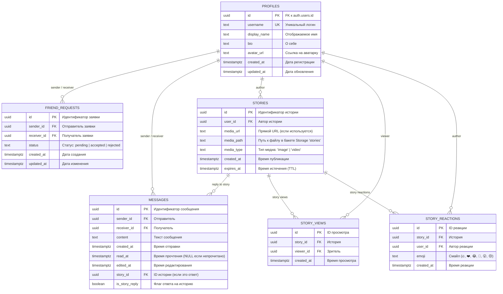

# 02. База данных Supabase и безопасность

## 1. Обзор архитектуры базы данных

В качестве серверной платформы и СУБД в Melo используется **Supabase** (на базе PostgreSQL). Все запросы к данным происходят напрямую из клиентского кода через PostgREST-клиент `@supabase/supabase-js` с передачей JWT-токена пользователя в заголовках.

---

## 2. Диаграмма связей базы данных (ERD)



---

## 3. Детальное описание таблиц и полей

### 1. `profiles`
Таблица расширенных профилей пользователей, привязанная к системной таблице `auth.users`.
- `id` (`UUID`, Primary Key): соответствует `auth.users.id`.
- `username` (`TEXT`, UNIQUE, NOT NULL): уникальный никнейм пользователя (от 3 символов, только латиница, цифры и знак `_`).
- `display_name` (`TEXT`, Nullable): человекочитаемое имя для отображения в интерфейсе.
- `bio` (`TEXT`, Nullable): текст описания профиля (до 500 символов).
- `avatar_url` (`TEXT`, Nullable): ссылка на изображение аватара в Supabase Storage.
- `created_at` (`TIMESTAMPTZ`): временная метка регистрации.
- `updated_at` (`TIMESTAMPTZ`): временная метка последнего редактирования.

### 2. `friend_requests`
Служит для организации дружбы между пользователями.
- `id` (`UUID`, Primary Key).
- `sender_id` (`UUID`, Foreign Key → `profiles.id`): отправитель заявки.
- `receiver_id` (`UUID`, Foreign Key → `profiles.id`): адресат заявки.
- `status` (`TEXT`): статус заявки. В коде поддерживаются значения `'pending'`, `'accepted'`, `'rejected'`.
- `created_at` (`TIMESTAMPTZ`).
- `updated_at` (`TIMESTAMPTZ`).

### 3. `messages`
Таблица личных сообщений между пользователями в чате 1-на-1.
- `id` (`UUID`, Primary Key).
- `sender_id` (`UUID`, Foreign Key → `profiles.id`): автор сообщения.
- `receiver_id` (`UUID`, Foreign Key → `profiles.id`): получатель сообщения.
- `content` (`TEXT`, NOT NULL): текст сообщения.
- `created_at` (`TIMESTAMPTZ`): время создания записи.
- `read_at` (`TIMESTAMPTZ`, Nullable): заполняется временем открытия чата получателем. Если `read_at IS NULL`, сообщение считается непрочитанным.
- `edited_at` (`TIMESTAMPTZ`, Nullable): заполняется при вызове функции `edit_own_message`.
- `story_id` (`UUID`, Nullable, Foreign Key → `stories.id`): идентификатор истории, если пользователь ответил на чужую историю.
- `is_story_reply` (`BOOLEAN`, Default `false`): флаг, сообщающий интерфейсу о необходимости отрендерить карточку превью истории.

### 4. `stories`
Публикации историй пользователей с временным сроком жизни.
- `id` (`UUID`, Primary Key).
- `user_id` (`UUID`, Foreign Key → `profiles.id`): создатель истории.
- `media_url` (`TEXT`): альтернативное поле URL (в коде часто оставляется пустым, так как используется безопасный `media_path`).
- `media_path` (`TEXT`, NOT NULL): относительный путь к файлу в бакете `stories` (формат: `${user.id}/${timestamp}-${filename}`).
- `media_type` (`TEXT`, NOT NULL): `'image'` или `'video'`.
- `created_at` (`TIMESTAMPTZ`).
- `expires_at` (`TIMESTAMPTZ`): время, после которого история считается недействительной.

### 5. `story_views`
Фиксация уникальных просмотров историй.
- `id` (`UUID`, Primary Key).
- `story_id` (`UUID`, Foreign Key → `stories.id`).
- `viewer_id` (`UUID`, Foreign Key → `profiles.id`).
- `created_at` (`TIMESTAMPTZ`).
*Примечание: в приложении используется уникальная пара `(story_id, viewer_id)`, чтобы исключить дублирование просмотров.*

### 6. `story_reactions`
Быстрые реакции на истории.
- `id` (`UUID`, Primary Key).
- `story_id` (`UUID`, Foreign Key → `stories.id`).
- `user_id` (`UUID`, Foreign Key → `profiles.id`).
- `emoji` (`TEXT`): символ смайла (например, 🔥, ❤️, 😂).
- `created_at` (`TIMESTAMPTZ`).

---

## 4. Хранимые процедуры (RPC), триггеры и Realtime

### RPC-функция `edit_own_message`
В `src/app/messages/page.tsx` редактирование сообщений выполняется через вызов:
```ts
const { error } = await supabase.rpc('edit_own_message', {
  p_message_id: messageId,
  p_new_content: newText,
});
```
**Назначение и логика на стороне PostgreSQL**:
```sql
CREATE OR REPLACE FUNCTION edit_own_message(p_message_id UUID, p_new_content TEXT)
RETURNS void
LANGUAGE plpgsql
SECURITY DEFINER
AS $$
BEGIN
  UPDATE messages
  SET content = p_new_content,
      edited_at = NOW()
  WHERE id = p_message_id AND sender_id = auth.uid();
  
  IF NOT FOUND THEN
    RAISE EXCEPTION 'Message not found or you are not the sender';
  END IF;
END;
$$;
```
Это гарантирует, что даже при наличии прямого доступа к API пользователь не сможет изменить текст чужого сообщения.

### Настройка Realtime (WebSockets)
В приложении используется механизм Supabase Realtime, слушающий поток логической репликации PostgreSQL:
```ts
supabase
  .channel(`messages-insert-${currentUser.id}`)
  .on('postgres_changes', { event: 'INSERT', schema: 'public', table: 'messages' }, handler)
  .subscribe();
```
Для корректной работы в панели Supabase таблица `messages` должна быть добавлена в публикацию `supabase_realtime`:
```sql
ALTER PUBLICATION supabase_realtime ADD TABLE messages;
```

---

## 5. Граница: Что подтверждено кодом vs Что предполагается в СУБД

| Элемент | Статус | Обоснование |
|---|---|---|
| Имена таблиц (`profiles`, `friend_requests`, `messages`, `stories`, `story_views`, `story_reactions`) | **Подтверждено кодом** | Явные вызовы `.from('...')` по всей кодовой базе |
| Поля таблиц и их типы | **Подтверждено кодом** | Явные выборки `.select(...)` и интерфейсы TypeScript |
| Бакеты Storage (`avatars`, `stories`) | **Подтверждено кодом** | Вызовы `.storage.from('avatars')` и `.storage.from('stories')` |
| RPC функция `edit_own_message` | **Подтверждено кодом** | Прямой вызов `supabase.rpc('edit_own_message', ...)` |
| Наличие миграционных `.sql` файлов в Git | **Отсутствует** | В репозитории нет папки `supabase/migrations`. Схема создавалась вручную через UI Supabase |
| RLS-политики | **Предполагается / Зависит от консоли** | Клиентский код опирается на авторизацию `auth.uid()`, но фактические правила `CREATE POLICY` хранятся в облаке Supabase |
| Автоматическое удаление файлов из Storage при удалении историй | **Частично** | В `stories/[id]/page.tsx` удаление из бакета и БД вызывается клиентом последовательно. В БД нет каскадного триггера на Storage |

---

## 6. Политики безопасности (Row Level Security — RLS)

Для защиты данных от несанкционированного доступа СУБД должна иметь следующие RLS-политики:

### 1. Таблица `profiles`:
```sql
-- Любой аутентифицированный пользователь может читать профили
CREATE POLICY "Public profiles are viewable by authenticated users"
ON profiles FOR SELECT TO authenticated USING (true);

-- Пользователь может обновлять только собственный профиль
CREATE POLICY "Users can update their own profile"
ON profiles FOR UPDATE TO authenticated
USING (auth.uid() = id)
WITH CHECK (auth.uid() = id);
```

### 2. Таблица `messages`:
```sql
-- Чтение доступно только отправителю или получателю
CREATE POLICY "Users can read their own conversations"
ON messages FOR SELECT TO authenticated
USING (auth.uid() = sender_id OR auth.uid() = receiver_id);

-- Отправка сообщений только от своего имени
CREATE POLICY "Users can insert messages as sender"
ON messages FOR INSERT TO authenticated
WITH CHECK (auth.uid() = sender_id);

-- Удаление разрешено только автору
CREATE POLICY "Users can delete own messages"
ON messages FOR DELETE TO authenticated
USING (auth.uid() = sender_id);
```

### 3. Таблица `stories`:
```sql
-- Просмотр историй доступен авторизованным пользователям
CREATE POLICY "Stories viewable by users"
ON stories FOR SELECT TO authenticated
USING (expires_at > NOW());

-- Публикация только от своего имени
CREATE POLICY "Users can insert own stories"
ON stories FOR INSERT TO authenticated
WITH CHECK (auth.uid() = user_id);

-- Удаление только автором
CREATE POLICY "Users can delete own stories"
ON stories FOR DELETE TO authenticated
USING (auth.uid() = user_id);
```

---

## 7. Безопасность Supabase Storage

### 1. Бакет `avatars`:
- **Тип доступа**: Публичный (`Public Bucket`).
- **Генерация URL**: `supabase.storage.from('avatars').getPublicUrl(filePath)`.
- **Клиентская валидация**:
  - Типы файлов: `image/jpeg`, `image/png`, `image/webp`.
  - Максимальный размер: `5 МБ` (`5 * 1024 * 1024` байт).

### 2. Бакет `stories`:
- **Тип доступа**: Приватный (`Private Bucket`).
- **Генерация URL**: `createSignedUrl(media_path, 300)`. Временная ссылка выдается ровно на **300 секунд (5 минут)**.
- **Преимущество**: Ссылка не может быть передана третьим лицам навсегда — через 5 минут она становится недействительной, защищая приватность медиа.

---

## 8. Аудит безопасности и рекомендации

1. **Валидация файлов на бэкенде**:
   - *Текущее состояние*: Проверка MIME-типа и размера файлов выполняется на клиенте (`AuthContext.tsx`, `StoriesBar.tsx`).
   - *Риск*: Злоумышленник может отправить файл любого размера и типа напрямую через PostgREST/Storage API.
   - *Рекомендация*: Настроить Storage RLS правила и ограничения размера бакета в конфигурации Supabase Dashboard.
2. **Удаление файлов историй**:
   - *Текущее состояние*: Удаление файла из Storage выполняется в `StoryViewerPage` клиентом. Если запрос к Storage прервется сетью, в Storage останется файл-сирота (orphaned file).
   - *Рекомендация*: Использовать Database Webhook или pg_cron задачу для периодической очистки неиспользуемых файлов Storage.
3. **Хранение секретов**:
   - В `.env.local` хранятся только публичные ключи (`NEXT_PUBLIC_SUPABASE_PUBLISHABLE_KEY`), что является безопасным для клиентских приложений. `service_role_key` в проекте не скомпрометирован.
