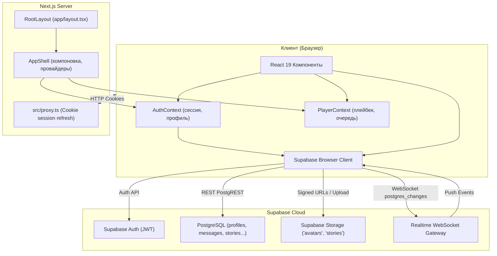

# 04. Архитектура приложения

## Архитектурные принципы

Приложение построено по гибридной архитектуре:
- **Next.js App Router (версия 16.3.6)** обеспечивает модульную маршрутизацию.
- **Client-Side Rendering (CSR)** активно используется на страницах (`'use client'`), так как платформа представляет собой интерактивное SPA с постоянным аудиоплеером, веб-сокетами и динамическими анимациями.
- **Supabase Cloud** выступает единым бэкендом (BaaS), предоставляя аутентификацию, реляционную базу данных PostgreSQL, хранилище медиафайлов и механизм подписки на события данных (Realtime).

---

## Архитектурная схема работы

---

## Контексты приложения
1. **`AuthContext`** (`src/context/AuthContext.tsx`):
   - Хранит текущего пользователя (`user`) и данные профиля (`profile`).
   - Инициализируется через `supabase.auth.getSession()` и реагирует на события `onAuthStateChange`.
   - Инкапсулирует методы `signIn`, `signUp`, `signOut`, `updateProfile`, `uploadAvatar`.
2. **`PlayerContext`** (`src/context/PlayerContext.tsx`):
   - Управляет активным треком (`currentTrack`), статусом воспроизведения (`isPlaying`), переходами вперед/назад.
   - Хранит состояние поискового запроса (`searchQuery`) для синхронизации поиска между шапкой и контентом.
   - Управляет флагом `mobileChatOpen`, оптимизирующим экранное пространство на смартфонах.

---

## Серверный файл `src/proxy.ts`
Функция `updateSession` из `src/proxy.ts` реализует механизм рефреша токенов через `@supabase/ssr`:
- Считывает куки из входящего `NextRequest`.
- Инициализирует `createServerClient`.
- Вызывает `supabase.auth.getUser()`, что обновляет просроченные токены и устанавливает свежие заголовки `Set-Cookie` в `NextResponse`.
