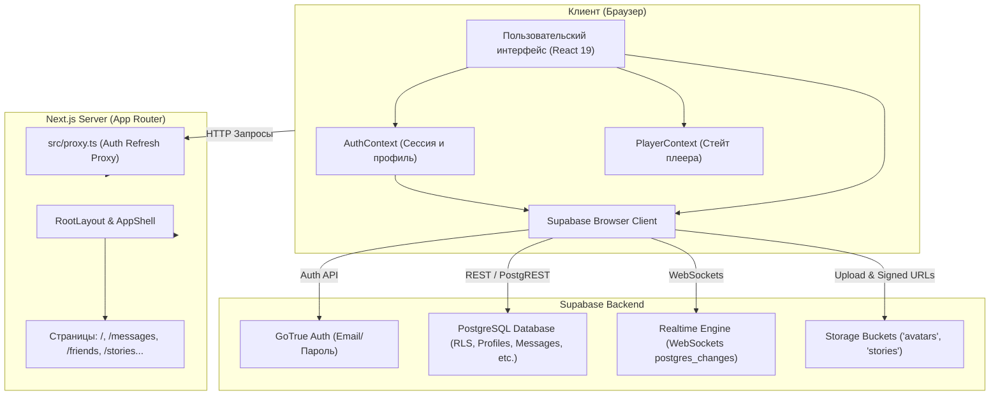

# Melo — Документация проекта

> **Melo** — это социальная веб-платформа для совместного прослушивания музыки, общения в реальном времени, обмена историями и взаимодействия с друзьями.

---

## 📌 Оглавление документации

Документация разбита на логические модули, расположенные в папке `docs/`:

1. [**01. Архитектура проекта и структура файлов**](./01_architecture_and_structure.md)
   - Общее описание и пользовательские сценарии
   - Полное дерево файлов и папок проекта
   - Схема импортов и зависимостей файлов (**Mermaid**)
   - Архитектурная схема работы сайта и потоков данных (**Mermaid**)
   - Работа Next.js App Router, серверные и клиентские компоненты
   - Контексты (`AuthContext`, `PlayerContext`) и файл `proxy.ts`

2. [**02. База данных Supabase и безопасность**](./02_database_and_security.md)
   - Таблицы базы данных: `profiles`, `friend_requests`, `messages`, `stories`, `story_views`, `story_reactions`
   - Диаграмма связей базы данных ERD (**Mermaid**)
   - RPC-функции (`edit_own_message`), триггеры, индексы и Realtime-репликация
   - Разделение сведений: что подтверждено кодом, а что конфигурируется на стороне Supabase
   - Политики безопасности RLS, Supabase Storage и аудит уязвимостей

3. [**03. Функциональные модули приложения**](./03_features_and_modules.md)
   - **Авторизация и профили**: регистрация, вход, сессии, валидация username, загрузка аватарок
   - **Друзья**: поиск, отправка заявок, принятие, отклонение, отмена, удаление, онлайн-статусы
   - **Личные сообщения**: чаты 1-на-1, Realtime подписки, статусы прочтения, редактирование, удаление, ответы на истории
   - **Истории (Stories)**: загрузка фото/видео, Supabase Storage, временные подписанные ссылки (`createSignedUrl`), автоплей, просмотры, реакции
   - **Музыка, плеер, комнаты и плейлисты**: глобальный плеер, синхронизация воспроизведения, разделение реального и демонстрационного (Mock) функционала

4. [**04. Установка, запуск и статус разработки**](./04_setup_and_status.md)
   - Системные требования и команды запуска (`npm run dev`, `build`, `lint`)
   - Необходимые переменные окружения (`.env.local`)
   - Пошаговая инструкция по развертыванию на новом устройстве
   - Что хранится в Git, а что существует в Supabase
   - **Сводная матрица статуса разработки** по всем модулям (Готово / Частично / Мок / Не создано)

---

## 🚀 Быстрый обзор: как устроен Melo

Приложение построено на базе современного стека **Next.js 16 (App Router) + React 19 + TypeScript + Supabase**.

### Общая схема взаимодействия:

### Ключевые принципы работы:
1. **Единая оболочка (AppShell)**: Меню навигации (`Navigation`), шапка поиска (`Header`) и музыкальный плеер (`Player`) смонтированы на уровне корневого макета, поэтому музыка не прерывается при переходе между страницами.
2. **Гибридные данные**: Социальная часть (пользователи, друзья, сообщения, истории) полностью работает с **настоящей базой данных Supabase** в реальном времени. Музыкальная часть (каталог треков, поиск музыки, очереди комнат) в текущей версии работает на **демонстрационных данных (Mock)**.
3. **Реактивность (Realtime)**: Мессенджер подписывается на изменения таблицы `messages` через веб-сокеты Supabase, мгновенно отображая новые сообщения, статус прочитанности и удаление.
